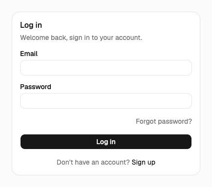
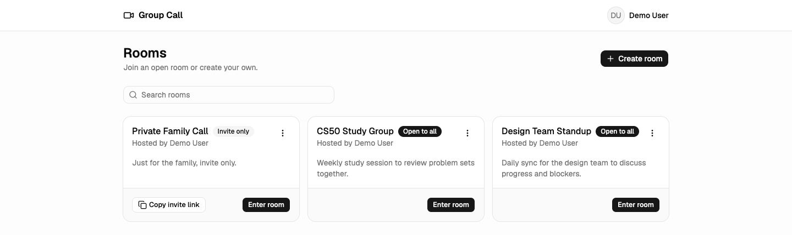
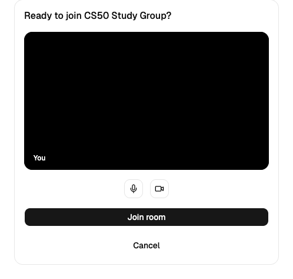
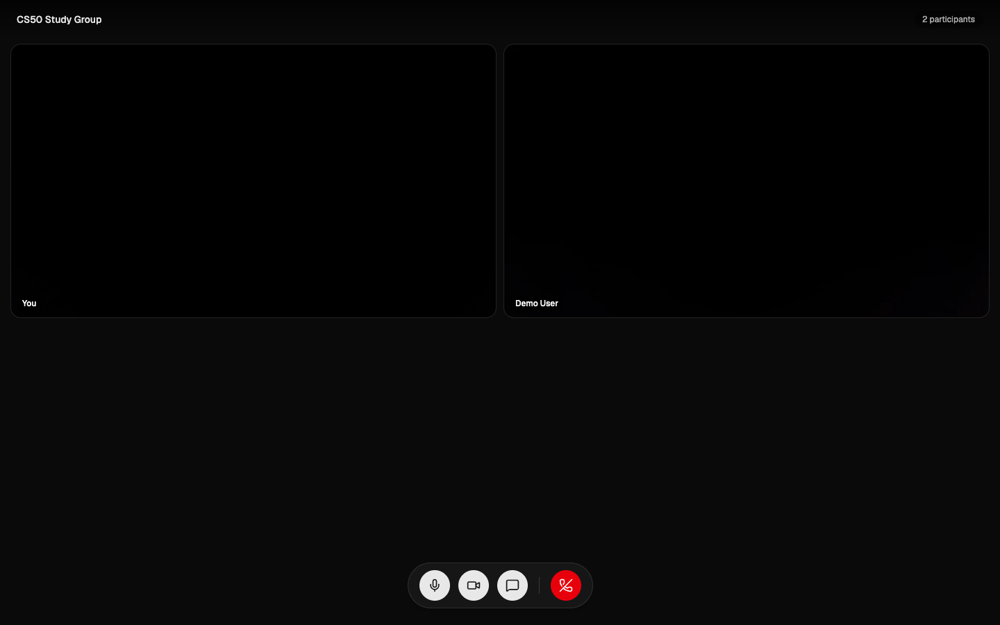
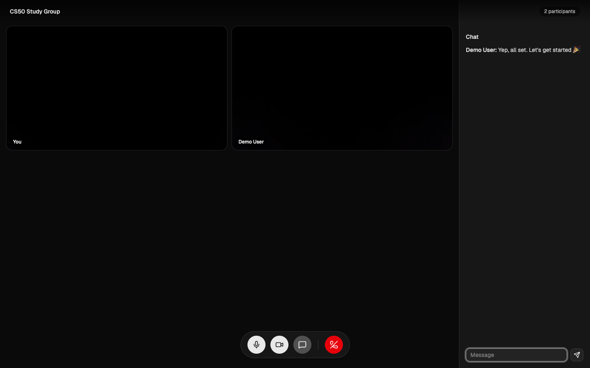
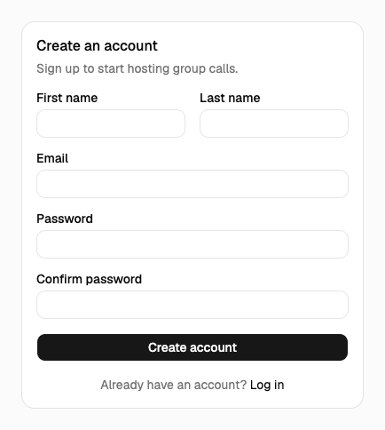
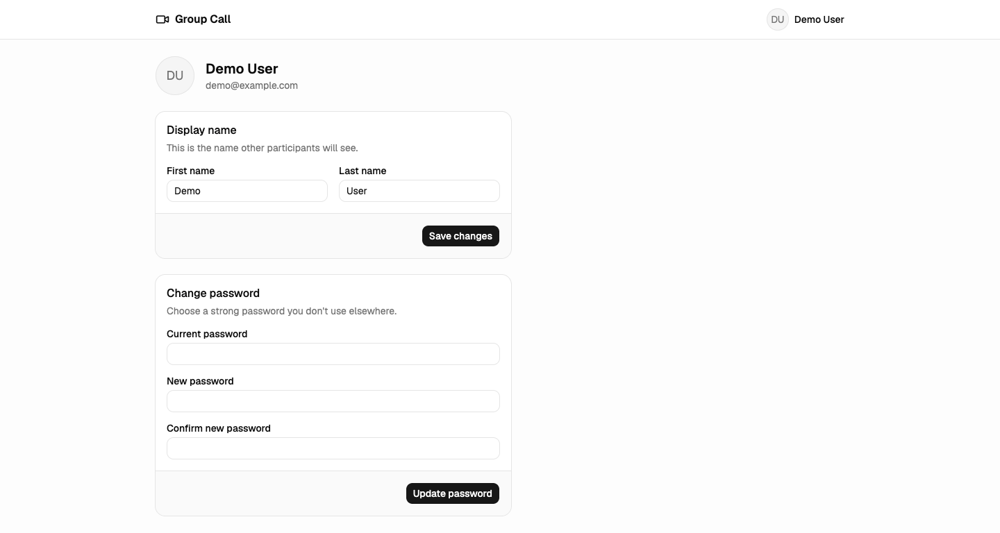

# Group Call

A group video calling app built with React and Django. People sign up, create public or invite-only rooms, and jump into a group call with live chat, powered by WebRTC for peer-to-peer video/audio and Django Channels for signaling.



## About this project

This app started life a few years ago as my final project for CS50's Web Programming course. Back then I had never touched React, Django REST Framework, or WebRTC, and the original build (a single tangled Django project with jQuery-ish frontend code sprinkled in) took me about four months of trial, error, and a lot of confused Googling to finish. It worked, it got me through the course, and I was proud of it. You can still find that original version on the [`legacy`](../../tree/legacy) branch.

This repository is a from-scratch rebuild of the same idea, done the way I'd approach it today. Same core concept, rooms, video calls, chat, but with a proper separation between a React/TypeScript frontend and a Django REST + Channels backend, real authentication, WebSocket-based signaling, TURN/STUN handling for NAT traversal, and a Dockerized dev/prod setup. It's less about the app itself and more a marker of how far I've come since that first attempt.

## Features

- Email/password authentication with JWT access & refresh tokens, plus forgot/reset password flows
- Create public ("open to all") or private ("invite only") rooms, with shareable invite links
- Pre-join screen to check your camera/mic before entering a call
- Peer-to-peer group video calls over WebRTC, with a TURN server for restrictive networks
- Real-time in-call text chat over WebSocket
- Profile management (display name, password change)

## Tech stack

| Layer | Technology |
|---|---|
| Frontend | React 19, TypeScript, Vite, React Router, TanStack Query, Zustand, React Hook Form + Zod, Tailwind CSS, shadcn/ui |
| Backend | Django, Django REST Framework, Django Channels (WebSocket signaling), Simple JWT |
| Realtime / media | WebRTC (peer-to-peer media), coturn (STUN/TURN), Redis (channel layer & cache in prod) |
| Data | SQLite by default, PostgreSQL when `DATABASE_URL` is set |
| Infra | Docker, Docker Compose, Nginx (frontend prod), Gunicorn + Uvicorn worker (backend prod) |

## How it fits together

- The **frontend** (Vite + React) talks to the **backend** over a REST API (`/api/...`) for auth, rooms, and TURN credentials, and over a WebSocket (`/ws/rooms/<room_slug>/`) for signaling.
- The **signaling** app (Django Channels) relays WebRTC offers/answers/ICE candidates between participants in a room and also carries the in-call chat messages. It uses an in-memory channel layer in dev, and Redis in prod so it can scale across workers.
- Once two browsers have exchanged signaling data, video/audio flows **directly between peers** (WebRTC). The **coturn** server only helps when a direct connection isn't possible, e.g. symmetric NATs or restrictive firewalls.

## Screenshots

| | |
|---|---|
| **Rooms lobby** |  |
| **Pre-join (camera check)** |  |
| **Group video call** |  |
| **In-call chat** |  |
| **Sign up** |  |
| **Profile settings** |  |

## Getting started

### Prerequisites

- [Docker](https://docs.docker.com/get-docker/) and Docker Compose (for the Docker setup)
- Or, for a Docker-free setup:
  - Python 3.13+
  - [Bun](https://bun.sh) (the frontend uses `bun.lock`; npm/pnpm/yarn will also work if you regenerate a lockfile)
  - Redis (optional in dev; the app falls back to an in-memory channel layer/cache if `REDIS_URL` isn't set)
  - coturn or another STUN/TURN server (optional in dev; calls on the same network work fine without it)

### Option A: Run with Docker

1. Copy the env file:
   ```bash
   cp .env.example .env
   ```

2. Build and start the frontend, backend, and coturn:
   ```bash
   docker compose up -d
   ```

3. Run migrations:
   ```bash
   scripts/migrate.sh
   ```

4. (Optional) Create an admin superuser:
   ```bash
   scripts/createsuperuser.sh
   ```

5. Open the app:
   - Frontend: http://localhost:5173
   - Backend API: http://localhost:8000/api/
   - Django admin: http://localhost:8000/admin/

To run the production images instead (Nginx-served frontend build, Gunicorn/Uvicorn backend, Redis-backed channel layer):

```bash
docker compose -f compose.prod.yml up -d --build
scripts/migrate.sh compose.prod.yml
```

### Option B: Run without Docker

1. **Backend**
   ```bash
   cd backend
   python -m venv .venv
   source .venv/bin/activate
   pip install -r requirements.txt
   ```

2. Export the required environment variables (see [Environment variables](#environment-variables) below), e.g.:
   ```bash
   set -a; source ../.env; set +a
   ```

3. Run migrations and start the dev server:
   ```bash
   python manage.py migrate
   python manage.py runserver 0.0.0.0:8000
   ```
   Django Channels patches `runserver` to serve both HTTP and WebSocket traffic, so no separate ASGI server is needed in dev.

4. **Frontend** (in a separate terminal):
   ```bash
   cd frontend
   bun install
   bun run dev
   ```
   Vite loads `VITE_API_BASE_URL` from a `.env` file inside `frontend/` (or from your shell environment). Copy the relevant value from the root `.env.example` into `frontend/.env` if you're not exporting it globally.

5. Open http://localhost:5173.

### Environment variables

| Variable | Used by | Description |
|---|---|---|
| `DEBUG` | backend | `True`/`False`. Defaults to `False`. |
| `SECRET_KEY` | backend | Django secret key. |
| `ALLOWED_HOSTS` | backend | Comma-separated hostnames; defaults to localhost. Render's public hostname is added automatically. |
| `DATABASE_URL` | backend | Optional database connection URL. Unset uses local SQLite; Render supplies PostgreSQL. |
| `FRONTEND_URL` | backend | Used for CORS and password-reset links. |
| `DEFAULT_FROM_EMAIL` | backend | "From" address for password-reset emails (console backend by default in dev). |
| `TURN_SECRET` | backend, coturn | Shared secret used to mint short-lived TURN credentials. |
| `TURN_REALM` | coturn | TURN realm. |
| `TURN_URLS` | backend | Comma-separated TURN/STUN URLs returned to the frontend. |
| `REDIS_URL` | backend | If set, uses Redis for the channel layer and cache; if unset, falls back to in-memory (single-process only). |
| `VITE_API_BASE_URL` | frontend | Base URL of the backend API. |

## Deploy on Render

The [Render deployment guide](docs/deploy-render.md) walks through deploying the
root `render.yaml` Blueprint: a free static frontend, one Django ASGI process,
and free PostgreSQL. It covers URL configuration, testing, free-tier limits, and
the external TURN/email services needed to test those features fully. Local
development and Docker Compose remain available with the same setup above.

## Migrations

- **Adding a migration** (after changing a model), dev only:
  ```bash
  scripts/makemigrations.sh
  ```
  Review the generated migration file, then commit it to git.

- **Running migrations**:
  ```bash
  scripts/migrate.sh              # dev
  scripts/migrate.sh compose.prod.yml   # prod
  ```

- **Rolling back a migration**:
  ```bash
  scripts/rollback.sh <app_label> <migration_name> [compose_file]
  ```
  Example: `scripts/rollback.sh main 0003_previous_migration`

## Project structure

```
.
├── backend/            # Django project
│   ├── config/         # settings, URLs, ASGI/WSGI entrypoints
│   ├── main/           # users, rooms, auth, REST API
│   └── signaling/      # WebSocket consumer for WebRTC signaling + chat
├── frontend/            # React app (Vite)
│   └── src/
│       ├── app/         # routing, providers
│       ├── features/    # auth, lobby, profile, video-room
│       └── shared/       # shared layouts/components
├── scripts/            # helper scripts for migrations, superuser creation, etc.
├── compose.yml         # dev Docker Compose
└── compose.prod.yml    # prod Docker Compose
```
